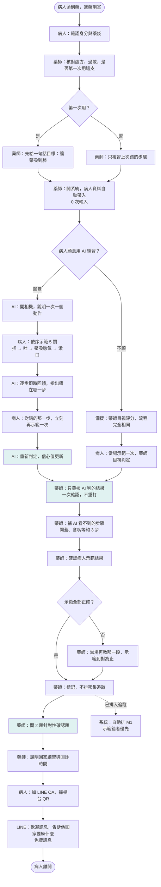
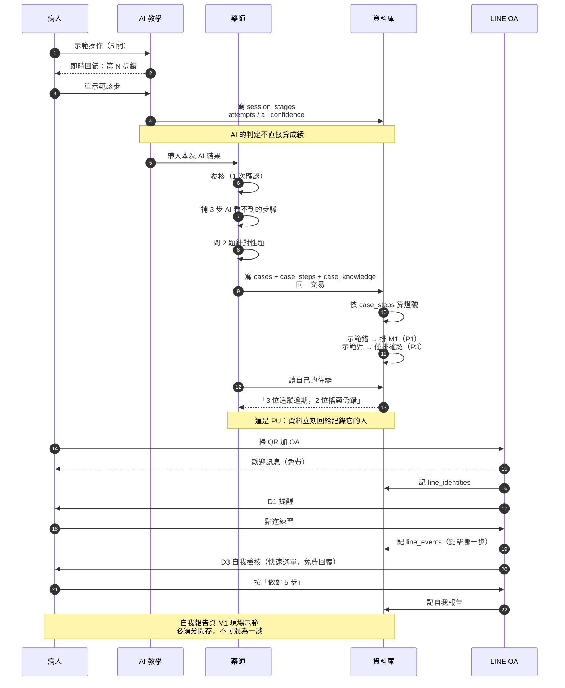

# 第一次領藥 → 藥劑室衛教：TAM 導向流程設計

日期：2026-10-09　分支：`feature/multimodal-v2`
狀態：設計規格（待實作）

本文件回答兩件事：既有成果用 TAM 重新診斷後要怎麼改；以及「病患第一次領到藥、
走進藥劑室、聽藥師衛教」這整段流程怎麼設計。

標準工具：UML use case（§3）、活動圖含泳道（§4）、時序圖（§5）。

---

## 1. TAM 診斷：既有成果為什麼沒有變成成效

TAM（Davis 1986；Venkatesh 2003 UTAUT）的兩條主軸是 **PEOU 感知易用性** 與
**PU 感知有用性**。採用率由這兩條決定，其餘（社會影響、促成條件）只在邊界上
起作用。QCC 的數據收集與 TAM 的假設剛好相反。

### 1.1 逐項診斷

| # | 既有成果 | PEOU（好不好用） | PU（對誰有用） | 診斷 |
|---|---|---|---|---|
| 1 | 平台雛形三端 | **負**：藥師收 1 案約需 25 次操作 | **負**：填完沒有任何回饋 | 平台存在，但它是為了填資料而存在的 |
| 2 | 標準化衛教工具 | 中性偏負：33 步全表單；台語語音僅有文字稿 | 中性：病人只聽不操作 | 工具正確，但不可用 |
| 3 | 病人介入資料 | Baseline 便宜所以收了；M1 貴所以沒收 | 收集者拿不到回饋 | **收集了便宜的資料，跳過了有價值的** |
| 4 | 主要研究指標 | — | **負**：算給報告看，不回給現場 | 指標不會改變行為，因為沒有人在現場看它 |
| 5 | 藥事衛教追蹤成果 | — | — | **0**（`byTimePoint = {M0:62, M1:0}`） |
| 6 | 研究成果報告 | — | — | 0 |

### 1.2 一句話診斷

> 每一項成果都是為了**醫院的報表需求**建造的，不是為了**兩個人的採用需求**。
> TAM 說採用是瓶頸，所以 1、3、5、6 全部是下游症狀。

### 1.3 證據

62 例全部是 M0，`trackingProgress = {hasData:false}`。M1=0 不是執行不力，
是採用失敗——這正是 TAM 預測的結果。

---

## 2. 重新擬定的計畫：把順序倒過來

原本：「收集資料 → 算指標 → 寫報告」。
改為：**每一步都必須讓下一步更省力**；每一筆被記錄的資料，必須當場回饋給記錄它的人。

| 階段 | 目標 | 驗收 |
|---|---|---|
| P1 降低操作成本 | 藥師收案 25 次 → **5 次** | 實測點擊次數 |
| P2 讓病人從聽變做 | 病人至少**示範 1 步** | 示範率 |
| P3 資料當場回饋 | 藥師下次開系統先看到自己的待辦 | 追蹤逾期數下降 |
| P4 AI 先判、人覆核 | AI 可判的步驟不進人工表單 | 人工輸入步數 |
| P5 LINE 只做延伸 | 不取代 M1 現場示範 | 額度與同意流程 |

**順序不能換。** P1 不做，後面每一項都會因為沒人用而失敗。

---

## 3. Use case（UML）

```mermaid
flowchart LR
  subgraph P[病人 / 照顧者]
    UC1[取得並看懂自己的藥]
    UC2[當場示範操作]
    UC3[得到即時回饋]
    UC4[回家練習]
    UC5[自我檢核並回報]
  end

  subgraph R[藥師]
    UC6[核對處方與用藥史]
    UC7[覆核 AI 判定]
    UC8[補評 AI 看不到的步驟]
    UC9[確認病人示範]
    UC10[挑 2 題針對性確認]
    UC11[看自己的待辦追蹤]
  end

  subgraph A[AI 教學系統]
    UCA1[逐步判斷操作]
    UCA2[回饋哪一步錯]
  end

  subgraph L[LINE OA]
    UCL1[歡迎訊息]
    UCL2[提醒練習]
    UCL3[收自我檢核]
  end

  UC1 --> UC2
  UC2 -.-> UC3 : <<include>>
  UC2 -.-> UCA1
  UCA1 -.-> UCA2
  UCA2 -.-> UC3
  UC6 --> UC7
  UC7 -.-> UC8
  UC7 -.-> UC9
  UC9 -.-> UC8 : <<extend>> 示範錯時才補
  UC8 --> UC10
  UC4 -.-> UCL1
  UCL1 -.-> UCL2
  UCL2 -.-> UCL3
  UC11 --> UC6
```

關鍵關聯：

- `<<include>>`：病人示範一定包含 AI 判斷與回饋，不可省略。
- `<<extend>>`：只有示範錯才補評，示範對時這段不發生——這就是工作量自動分流的來源。
- `藥師 看自己的待辦追蹤` 與 `核對處方` 之間有依賴，因為待辦是工作的入口。

---

## 4. 活動圖：第一次領藥進藥劑室（泳道）



**綠底三格是本設計的槓桿**：它們把藥師的操作量從 25 次降到約 5 次。

---

## 5. 時序圖：兩邊的資料如何串起來



---

## 6. 關鍵設計決定

| 決定 | 理由 |
|---|---|
| 病人從「聽」改成「做」 | PU 最高、PEOU 最低。示範一次成本是一個動作，卻同時產生 AI 判定與病人參與證據 |
| 藥師從「填 25 下」改成「確認 5 下」 | PEOU 是採用率的瓶頸。AI 判好的不重打，是唯一有效的降法 |
| 補評用 `<<extend>>` 而非必做 | 示範對的人不需額外處理，工作量自動集中到真正需要的人 |
| 每筆資料當場回饋 | 否則資料只是報表，不會改變行為 |
| AI 是選項不是門檻 | 不願用相機的病人走目視備援，流程與資料結構完全相同 |
| 自我報告與現場示範分開存 | 前者會高估。混在一起會讓 LINE 看起來比實際有效 |
| M1 現場示範是唯一成效證據 | LINE 只是延伸；沒有 M1 就無法回答「有沒有變好」 |

---

## 7. 不變的東西

- 33 步 spine 與 ★ 標記（`src/domain/steps.js`）不變
- QCC 附件七查檢表不變
- 病歷號碼只存雜湊，畫面只顯示末 2 碼不變
- LINE 不取代 M1，只負責 D1／D3／D7

## 8. 本設計要解決的已知阻礙

1. **AI 只能判 pMDI 的 4 關**。乾粉與軟霧流程尚未建置，所以「AI 覆核」目前只對 MDI 成立。
2. **台語語音不存在**。prototype 只有文字稿，明載需母語者校對後錄音。
3. **LINE 同意流程未定**。共用手機的長者會讓推播內容被旁人看到。
4. **護理人力**：覆核 5 下是設計目標，實際需量測後確認。